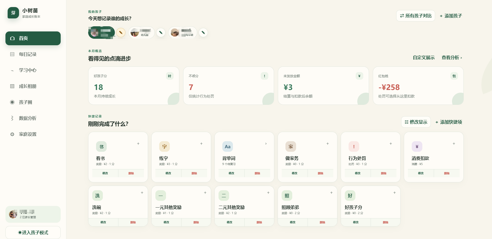
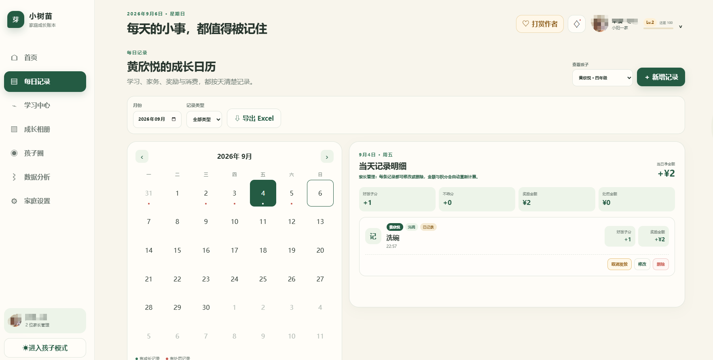
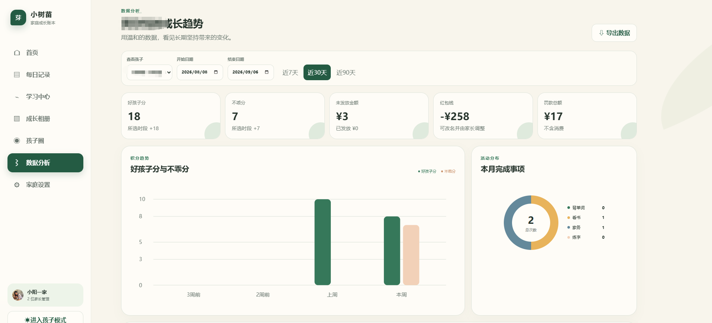
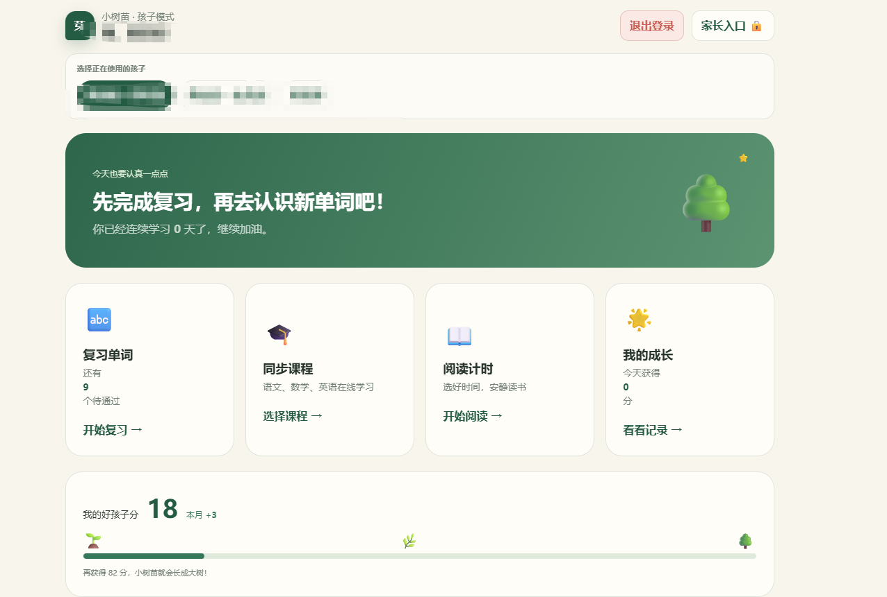

## 在线体验

[访问小树苗家庭成长记录](https://sunout.cn/)

# 小树苗 · 家庭成长账本

一个面向家庭的儿童成长记录与学习管理工具。家长可以记录孩子每天完成的事情、奖励与处罚，管理多个孩子，查看成长数据，并为阅读、课程和幼小衔接学习保存计时记录；孩子可以在受保护的孩子模式中完成学习任务。

本项目是一个无需构建工具即可运行的响应式 Web 应用，适合直接部署到 GitHub Pages、静态托管服务或自己的 Web 服务器。

## 项目特点

- 手机优先的响应式界面，同时兼容平板和桌面浏览器。
- 支持多个孩子、孩子切换、孩子头像、年级和成长档案。
- 家长首页展示积分、金额、学习次数、红包钱和未发放金额等数据。
- 每日记录支持看书、练字、背单词、家务、处罚、消费和自定义项目。
- 家长可以查看、修改和删除记录；修改或删除后会自动重新计算金额和积分。
- 支持奖励确认、取消发放、恢复发放，以及处罚从“未发放金额”或“红包钱”扣除。
- 学习中心包含单词背诵、单词复习、幼小衔接、同步课程和阅读计时。
- 单词库按小学三至五年级上/下册、初中和高中核心词汇区分。
- 单词复习采用间隔复习计划；没有到期复习时可以继续学习新词，到期后先完成当次复习。
- 阅读计时和课程计时支持开始、暂停、继续和终止，并保存完整时长记录。
- 阅读记录支持四大名著文言文原著，以及其他课外书计时。
- 家长可以对学习记录进行确认、修改和删除。
- 成长相册支持上传、分类、按月查看和下载。
- 支持孩子模式，并通过密码验证返回家长模式。
- 支持家庭成员邀请、共同家长和多个家庭之间切换（需要配置 Supabase）。
- 支持操作记录、数据统计、图表和 Excel 导出。

## 技术说明

这是一个静态前端项目，主要由以下技术组成：

- HTML5
- CSS3
- 原生 JavaScript（无前端框架依赖）
- 浏览器 `localStorage` 保存本地体验数据
- IndexedDB 保存本地照片等较大媒体数据
- Supabase Auth、Database、Storage 和 RPC（正式云端模式）

## 目录结构

```text
.
├─                   # 可直接打开或部署的完整静态网站
│  ├─ index.html             # 主页面
│  ├─ app.js                 # 页面逻辑、状态管理和交互
│  ├─ styles.css             # 全部页面样式和移动端适配
│  ├─ config.js              # Supabase 项目配置
│  ├─ assets/                # 图片、书籍全文和其他静态资源
│  ├─ supabase-setup.sql     # 首次初始化数据库脚本
│  ├─ supabase-family-upgrade.sql
│  ├─ DEPLOYMENT.md          # 部署说明
│  └─ README.md              # 静态部署目录的简要说明
├─ site-release/             # 已同步的发布目录
├─ dist/public/              # 可用于静态托管的发布目录
└─ README.md                 # GitHub 项目说明（当前文件）
```

## 本地运行

### 方式一：直接打开

进入 `outputs` 文件夹，双击 `index.html` 即可运行本地体验版。

体验账号通常为：

```text
邮箱：demo@sunout.cn
密码：123456
```

直接打开文件时，部分浏览器会限制模块资源、IndexedDB 或跨页面功能。推荐使用下面的本地静态服务器方式。

### 方式二：使用 Python 静态服务器

在项目根目录执行：

```bash
cd outputs
python -m http.server 8080
```

然后打开：

```text
http://localhost:8080
```

也可以使用 VS Code Live Server、Node.js 静态服务器或任意其他静态文件服务器。

## Supabase 正式模式配置

不配置 Supabase 时，项目使用浏览器本地数据，适合演示和单设备体验。若需要邮箱注册、验证码、跨设备同步、共同家长、云端相册等功能，请配置 Supabase。

### 1. 创建 Supabase 项目

在 Supabase 创建项目后，打开项目的 Project Settings，取得：

- Project URL
- anon public key

将 `config.js` 中的占位配置替换为自己的项目配置。不要把 `service_role` 密钥放进前端文件，也不要提交到 GitHub。

### 2. 执行数据库脚本

在 Supabase SQL Editor 中按顺序执行：

1. `supabase-setup.sql`
2. 如果使用共同家长、多家庭切换，再执行 `supabase-family-upgrade.sql`

共同家长升级脚本最后的检查结果应全部为 `true`。

### 3. 配置邮箱验证码

在 Supabase Authentication 中配置 Site URL、Redirect URLs 和邮箱 SMTP。项目支持注册、登录、验证码验证及找回密码流程。详细说明见：

- `SUPABASE_EMAIL_OTP_SETUP.md`
- `DEPLOYMENT.md`

### 4. 配置云端相册

云端相册需要在 Supabase Storage 中创建对应 bucket，并配置相应访问策略。正式环境请使用私有 bucket 和临时签名链接，不要把儿童照片设置为公开资源。

## 部署到 GitHub Pages

推荐将整个项目上传到 GitHub，然后在仓库设置中：

1. 打开 `Settings` → `Pages`。
2. 在 `Build and deployment` 中选择 `Deploy from a branch`。
3. 选择需要发布的分支。
4. 如果将 `outputs` 作为发布目录，建议把网站文件复制到分支根目录，或使用 GitHub Actions 将 `outputs` 发布为 Pages artifact。

如果只是使用静态体验版，也可以只上传 `outputs` 文件夹中的网站文件。若需要保留完整项目说明、SQL 脚本和部署文档，建议上传整个仓库。

## 安全注意事项

- 不要提交 Supabase `service_role` key、数据库密码、SMTP 密码或其他私密凭证。
- 前端只能使用 Supabase anon public key，并依靠 RLS（Row Level Security）限制数据访问。
- 上线前请确认所有表都启用了 RLS，并检查每条 policy 的读写范围。
- 儿童姓名、生日、头像、照片和学习记录属于敏感家庭数据，请使用私有仓库或确认仓库内容不包含真实数据。
- `localStorage` 和 IndexedDB 适合本地体验，不适合作为唯一的生产数据备份。
- 项目中的奖励、处罚、红包和金额仅为家庭记录工具，不代替真实资金结算。

## 数据与隐私

本地体验数据保存在当前浏览器中。清除浏览器站点数据可能导致本地体验数据丢失。正式云端模式的数据由 Supabase 保存，具体保存区域、保留期限和访问权限应以部署者自己的隐私政策为准。

项目内置：

- `terms.html`：用户协议
- `privacy.html`：隐私政策

部署前请根据实际运营主体、数据存储位置和联系方式修改这些文件。

## 常见问题

### 为什么邮箱验证码收不到？

检查垃圾邮件、Supabase SMTP 配置、发件域名和邮箱模板。确认前端配置的是正确 Project URL 和 anon key。

### 为什么共同家长邀请报错？

确认已经执行最新版 `supabase-family-upgrade.sql`，并检查脚本最后的 RPC 检查项是否全部为 `true`。

### 为什么刷新后本地数据不见了？

确认仍在使用同一个浏览器、同一个域名或同一个本地文件来源。不要使用无痕窗口，也不要随意清除站点数据。生产环境建议配置 Supabase 云端保存。

### 为什么家长看不到修改和删除按钮？

确认当前处于家长模式，而不是孩子模式。家长模式下每日记录、阅读记录、课程记录和幼小衔接记录均提供相应管理按钮。

## 版本与发布

每次修改前端资源后，请同步更新 `index.html` 中 `app.js` 或 `styles.css` 的查询版本号，避免浏览器继续使用旧缓存。发布前建议检查：

```bash
node --check app.js
```

然后用手机尺寸和桌面尺寸各打开一次，检查登录、记录保存、编辑删除、学习计时、家长确认和页面刷新后的数据状态。

## 许可证

本项目采用 MIT License，详情请查看 [LICENSE](LICENSE) 文件。

## 开源说明

小树苗是一个面向家庭教育的成长记录网页项目，帮助家长记录孩子的日常表现、学习情况、奖励处罚和成长数据。

本项目采用 MIT License 开源。你可以自由使用、复制、修改和再发布本项目，但请保留原作者及许可证声明。

项目仅供学习和家庭管理使用，不构成任何专业教育或财务建议。使用者需要自行保护儿童姓名、照片、学习记录和账号信息等隐私数据。

欢迎提交 Issue 和 Pull Request，共同改进项目。

在线体验：https://sunout.cn/


## 界面预览

### 首页与成长数据



### 每日记录



### 数据分析



### 孩子模式与学习入口


